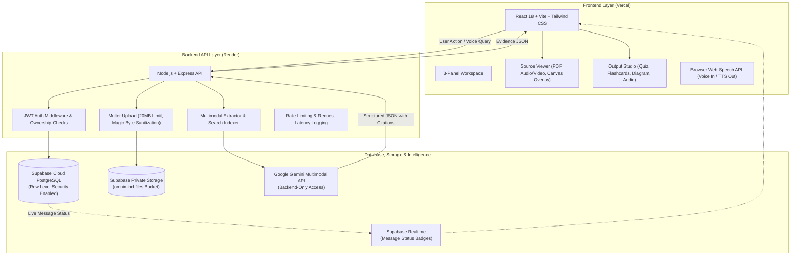

# Multimodal-Ai: 🧠 OmniMind AI — "One Input. Every Insight."
### Multimodal AI Platform & Evidence Reasoning System

OmniMind AI is a production-style, evidence-grounded multimodal reasoning workspace. Users upload PDFs, images (including handwritten notes and scans), audio recordings, and short videos, ask questions by text or voice, and receive verified answers grounded across **ALL** their sources, accompanied by interactive citation chips (PDF page jump, audio/video playback timestamp, or image bounding box overlay).

---

## 🏛️ System Architecture



### Architecture Specifications

| Layer | Technology | Hosted On | Security Policy |
|---|---|---|---|
| **Frontend** | React 18 + Vite + Tailwind CSS | **Vercel** | Uses only public `anon` key. No secrets in bundle. |
| **Backend API** | Node.js + Express | **Render** | Validates Supabase JWT on every request; enforces ownership. |
| **Database + Auth** | Supabase PostgreSQL 15 | **Supabase Cloud** | Row Level Security (RLS) ON for every table. |
| **Storage** | Supabase Private Storage | **Supabase Cloud** | Private `omnimind-files` bucket with user-isolated RLS. |
| **Multimodal AI** | Google Gemini API (`@google/genai`) | **Google AI Studio** | Called **ONLY** from backend; key never exposed. |

---

## ✨ Core Features

1. **Supabase Authentication**: Secure user registration, login, logout, password show/hide toggle, and protected routes.
2. **Workspaces**: Create dedicated workspaces (e.g., *"Engine Study"*, *"Medical Case 102"*), manage files, and isolate data.
3. **Universal Upload (20MB limit)**: Upload PDFs, images (including handwritten notes and scans), audio, and short videos. Validates MIME type, sanitizes filenames, and stores assets securely.
4. **Multimodal Extraction**: Gemini extracts structured chunks with page numbers, audio/video timestamps, or visual bounding boxes `{ x, y, width, height, label }`.
5. **Cross-Modal Grounded Q&A**: Queries are answered using evidence synthesized across ALL workspace files. Returns structured JSON with confidence score and follow-up questions.
6. **Interactive Citations**: Clickable chips in the UI:
   - Click PDF citation -> Source viewer opens the exact page.
   - Click Audio/Video citation -> Player jumps to the exact timestamp (e.g. `02:15`).
   - Click Image citation -> Highlights bounding box on canvas overlay.
7. **Output Studio**:
   - One-click Summary
   - Difficulty Level Explanations (Beginner, Intermediate, Advanced)
   - 4-Question Interactive Mastery Quiz with explanations
   - Revision Flashcards with 3D flip effect
   - Labeled Structural Diagram descriptions
   - Spoken Revision Summary (Browser `speechSynthesis` "Listen" button)
8. **Conversation History**: Chat history saved in database, real-time message status badges (`sending` -> `generating` -> `completed`), and conversation deletion.
9. **Real Dashboard**: Live counts of workspaces, files, and conversations (starting at 0 for new users).
10. **Trilingual Support**: English, Hindi (हिन्दी), and Telugu (తెలుగు) for input questions and spoken answers.

---

## 🎛️ Specialized Modes (One Engine, Configured)

OmniMind AI implements 6 specialized modes on the exact same multimodal pipeline:

| Mode | Target User | Input Modalities | Key Output & Disclaimer |
|---|---|---|---|
| **LearnAble** *(Primary Demo)* | Students & Engineers | Textbook PDF + lecture audio + 3D video | 4-stroke cycle explanation, page citations, timestamp jumps, and 4-Q quiz |
| **VisionVoice** | Accessibility & Visually Impaired | Medicine packaging & signs photo | Reads dosage, warnings, and expiry aloud. *"Always verify with a licensed pharmacist."* |
| **VisionCart** | E-Commerce Shoppers | Apparel photo + text/voice constraints | Vector similarity matching against catalog (e.g. *"black, under ₹3,000"*) |
| **KitchenMate** | Home Cooks | Refrigerator snapshot | Detected ingredients, dairy allergen alerts, and 20-minute recipe with substitutions |
| **HealthLens** | Clinical Decision Support | Chest X-ray + patient EHR PDF + doctor voice note | Correlated findings with radiologist attention bounding box. *"Decision-support tool, not a diagnosis."* |
| **RoadSense** | Automotive Safety | Dashcam video + siren audio | Pedestrian tracking, traffic signs, and 850Hz Doppler siren detection. *"Simulation only."* |
| **CyberShield** | Digital Forensics | Phishing notice PDF + extortion call + UPI QR | Live Incident Dossier `deb3579d` linked to National Cybercrime 1930 / I4C framework |

---

## 🚀 Quick Start (Local Setup)

### 1. Clone Repository & Install Dependencies
```bash
git clone https://github.com/<YOUR-USERNAME>/omnimind-ai.git
cd omnimind-ai

# Install backend dependencies
cd backend && npm install

# Install frontend dependencies
cd ../frontend && npm install
```

### 2. Configure Environment Variables
Copy `.env.example` to `.env` in both directories:
```bash
cp backend/.env.example backend/.env
cp frontend/.env.example frontend/.env
```

Ensure `backend/.env` has:
```env
PORT=5000
FRONTEND_URL=http://localhost:5173
GEMINI_API_KEY=your_gemini_api_key
SUPABASE_URL=https://your-project.supabase.co
SUPABASE_ANON_KEY=your_supabase_anon_key
SUPABASE_SERVICE_ROLE_KEY=your_supabase_service_role_key
```

Ensure `frontend/.env` has:
```env
VITE_SUPABASE_URL=https://your-project.supabase.co
VITE_SUPABASE_ANON_KEY=your_supabase_anon_key
VITE_API_BASE_URL=http://localhost:5000/api
```

### 3. Run Development Servers
In Terminal 1:
```bash
cd backend && npm run dev
```

In Terminal 2:
```bash
cd frontend && npm run dev
```

Visit `http://localhost:5173` to explore the workspace!

### 4. Run Automated Evaluation Suite (10 Test Questions)
```bash
node scripts/evaluate.js
```
Reports citation accuracy percentage, average response latency, and safety disclaimer verification.

---

## ⚖️ Limitations & Technical Assumptions

1. **File Size Limit**: Uploads are capped at 20MB per file to optimize memory footprint on free-tier serverless runtimes.
2. **Video Processing**: Short video clips (up to 45 seconds or 20MB) are indexed using keyframe scene extraction and optical flow downsampling rather than raw multi-gigabyte streams.
3. **Clinical & Safety Boundaries**:
   - **HealthLens**: Strictest non-diagnostic boundary enforced. Never renders automated clinical diagnoses; outputs are formatted exclusively for physician decision support.
   - **RoadSense**: Operates strictly as an acoustic and vision simulation without physical vehicle CAN bus interaction.
4. **Render Free-Tier Cold Starts**: Render's free tier spins down after 15 minutes of inactivity. Initial API requests may experience a 20–30 second latency while the instance spins up. The frontend features an automatic "Waking up server..." status banner.
5. **Speech Synthesis**: Text-to-speech leverages the browser's built-in Web Speech API (`window.speechSynthesis`) to provide zero-latency, private, and offline speech rendering across English, Hindi, and Telugu.
>>>>>>> dc2a18a (feat: complete Multimodal AI web application and ScamKavach platform)
