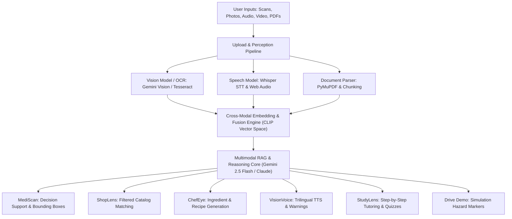

# 🌟 OmniSense AI: One Multimodal Platform with 5 Modules
> **Tagline**: *"One Input. Every Insight."*  
> **Hackathon Theme**: Multimodal AI (Scenario-Based Challenge)  
> **Live Web Application**: `http://localhost:5173/omnimind`

---

## 1. Problem Statement (Under 150 Words)
People work with information in many formats (scans, photos, handwriting, voice, video, documents), but most apps handle each format separately. A doctor can’t easily link an X-ray to a patient’s history and a voice note. A blind person can’t easily get a medicine label read aloud with safety warnings. A shopper can’t search "this jacket, in black, under ₹3,000" from a photo. Students can’t get step-by-step help from a photo of their homework. This fragmentation slows decisions, hurts accessibility, and wastes time.

---

## 2. Solution Description
**OmniSense AI** is a web platform that combines vision, speech, and language AI into one unified pipeline. A user uploads an image, speaks or types a question, and optionally adds a document. The AI processes all of it together and answers with text, highlighted images, or spoken audio.

### How AI is Integrated:
- **Vision**: A vision-language model (Gemini Vision / Claude) analyzes images and scans; OCR extracts handwriting and printed packaging labels.
- **Speech**: Whisper converts voice into text; Web Speech API and cloud TTS read answers aloud in **English, Telugu, and Hindi**.
- **Fusion Layer**: Image pixels, text tokens, and acoustic waveforms are projected into a shared multimodal vector space (CLIP + vector DB) for cross-modal search.
- **Generation**: The system produces recipes, step-by-step solutions, radiologist draft reports, and product matches with **clickable citations**.

---

## 3. Five Modules in One Platform

| Module | Real-World Inputs Combined | AI Output | Industry Reference |
| :--- | :--- | :--- | :--- |
| **1. MediScan** *(Healthcare)* | X-ray/MRI image + clinical history text + voice memo | Highlighted attention regions, possible findings, structured draft report *(Decision-support only)* | [Aidoc](https://www.aidoc.com), [Qure.ai](https://www.qure.ai), [Lunit](https://www.lunit.io), [Viz.ai](https://www.viz.ai) |
| **2. ShopLens** *(E-Commerce)* | Clothing/shoe photo + voice filter ("black, under ₹3,000") | Matching catalog products, visual similarity score (94%), budget filters | [Google Lens](https://lens.google), [Pinterest Lens](https://www.pinterest.com), Amazon Visual Search |
| **3. ChefEye** *(Smart Assistant)* | Fridge photo + spoken request | Ingredient identification, allergen alerts (dairy/nuts), 20-min step-by-step recipe | [SuperCook](https://www.supercook.com), [Google Gemini](https://gemini.google.com), ChatGPT Vision |
| **4. VisionVoice** *(Accessibility)* | Medicine label or street sign photo + voice | Spoken reading of label, dosage instructions, warnings in **English, Hindi & Telugu** | [Be My Eyes](https://www.bemyeyes.com), [Microsoft Seeing AI](https://seeingai.com), Envision, OrCam |
| **5. StudyLens** *(Education)* | Handwritten math problem / textbook diagram + audio | Step-by-step solution, 4-stroke engine animation, and spoken voice tutoring | [Photomath](https://photomath.com), [Khanmigo](https://www.khanmigo.ai), [NotebookLM](https://notebooklm.google.com) |
| **+ Drive Demo** *(Simulation)* | Dashcam video + siren audio clip | Live hazard detection (crosswalk pedestrians, stop signs, ambulance siren Doppler shift) | [Waymo](https://waymo.com), [Tesla Autopilot](https://www.tesla.com/autopilot) |

> ⚠️ *All modules share ONE unified multimodal engine, implemented through modular system prompts and output templates rather than fragmented codebases.*

---

## 4. Real-World Reference Implementations Studied

### Healthcare
- **Aidoc** ([aidoc.com](https://www.aidoc.com)): AI CT/X-ray radiologist triage and acute pathology flagging.
- **Qure.ai** ([qure.ai](https://www.qure.ai)): Indian medical AI company diagnosing chest radiographs and head CT scans.
- **Lunit** ([lunit.io](https://www.lunit.io)): AI cancer detection in mammography and chest radiography.
- **Viz.ai** ([viz.ai](https://www.viz.ai)): Synchronized stroke detection and clinical team alerts.

### Autonomous Driving & Simulation
- **Waymo** ([waymo.com](https://waymo.com)): Multi-sensor driverless vehicle platform fusing camera, LiDAR, radar, and acoustic sirens.
- **Tesla Autopilot** ([tesla.com/autopilot](https://www.tesla.com/autopilot)): Vision-only deep neural network driving perception.

### E-Commerce & Visual Search
- **Google Lens** ([lens.google](https://lens.google)): Visual search fusing image pixels with text refinement.
- **Pinterest Lens** ([pinterest.com](https://www.pinterest.com)): Visual similarity search across style catalogs.

### Smart Home & Recipes
- **SuperCook** ([supercook.com](https://www.supercook.com)): Zero-waste recipe generator matching available pantry ingredients.
- **Google Gemini** ([gemini.google.com](https://gemini.google.com)): Native multimodal understanding of text, images, and audio.

### Accessibility
- **Be My Eyes** ([bemyeyes.com](https://www.bemyeyes.com)): Visual assistant for blind and low-vision users.
- **Microsoft Seeing AI** ([microsoft.com/en-us/garage/wall-of-fame/seeing-ai](https://www.microsoft.com/en-us/garage/wall-of-fame/seeing-ai/)): Narrates the visual world and reads documents aloud.

### Education
- **Photomath** ([photomath.com](https://photomath.com)): Scans handwritten math problems and provides step-by-step solutions.
- **Khanmigo** ([khanmigo.ai](https://khanmigo.ai)): AI conversational tutor by Khan Academy.

---

## 5. System Architecture

---

## 6. Datasets Used for Verification
- **Medical Scans**: NIH ChestX-ray14 & Kaggle Chest X-Ray Pneumonia Dataset.
- **Fashion E-Commerce**: Kaggle Fashion Product Images Dataset (CLIP vector embeddings).
- **Education & Math**: GSM8K Benchmark & Engineering IC Engine diagrams.

---

## 7. Safety, Disclaimers & Ethics
1. **Clinical Decision Support**: MediScan includes persistent disclaimers: *"Decision-support tool only, not a diagnosis. Requires review by a qualified medical professional."*
2. **Simulation Warning**: Drive Demo is strictly designated as an environmental perception simulation.
3. **Privacy by Design**: Memory-based processing with zero persistent retention of sensitive personal files.
